<p align="center">
  
</p>

# Upscaler

Make images 2× or 4× larger with [Real-ESRGAN](https://github.com/xinntao/Real-ESRGAN) and
[ESRGAN](https://github.com/xinntao/ESRGAN) by Xintao Wang et al., right in the browser.
Images never leave the device: the models run locally through
[ONNX Runtime Web](https://github.com/microsoft/onnxruntime), on WebGPU (in half precision when the GPU supports
`shader-f16`) or on WebAssembly.

Live at **https://cassianokc.gitlab.io/upscaler/**

## Run it locally

You need [Node.js](https://nodejs.org/) 22 or newer and [uv](https://docs.astral.sh/uv/).

```sh
uv run export.py   # downloads the Real-ESRGAN weights and writes public/esrgan_x{2,4}{,_fp16}.onnx
npm install
npm run dev        # http://localhost:5173
```

The models are not in git (64 MB each in fp32, 32 MB in fp16); `export.py` recreates them. It pins its
dependencies in `export.py.lock`, so every run produces the same files.

### Debugging switches

Add these to the page URL to force a slower path, e.g. to compare them on a phone:

- `?backend=wasm`: run on WebAssembly instead of WebGPU.
- `?precision=fp32`: use the full-precision models on WebGPU.

The console says which backend and precision were chosen, and why.

## Test

```sh
npm run lint
npx playwright install   # once: downloads Chromium, Firefox and WebKit
npm test
```

The tests run in all three browsers. WebGPU cases are skipped where there is no hardware adapter (headless
Chromium only has the SwiftShader software renderer, and Playwright's Firefox has none), and fp16 cases also
need `shader-f16`.

## Build and deploy

```sh
npm run build     # writes dist/
npm run preview   # serves dist/
```

Every push to `main` runs `.gitlab-ci.yml`: the `models` job runs `export.py` (cached until `export.py` or its
lock file changes), `lint` and `test` check the code, and the `pages` job builds the app and publishes it to
GitLab Pages once both pass.

The build-time variables are there for observability of the main deploy at
https://cassianokc.gitlab.io/upscaler/. Local builds and forks can leave them unset, in which case the app
sends nothing anywhere. The two below are protected, masked CI/CD variables on the project; CI also sets
`VITE_SENTRY_RELEASE` to `upscale@<commit>` so each report names the deploy it came from.

| Variable | Enables |
| --- | --- |
| `VITE_SENTRY_DSN` | Sentry error reports and logs |
| `VITE_GOATCOUNTER_URL` | GoatCounter page views and usage events |

## Code map

| File | What it does |
| --- | --- |
| `export.py` | Converts the PyTorch weights to ONNX, in fp32 and fp16 |
| `src/platform.js` | Picks the backend and model precision for the browser |
| `src/upscale.js` | Loads the models and upscales an image tile by tile |
| `src/batch.js` | Runs a selection or a folder, one image at a time, and zips the results |
| `src/png.js` | Streams the result to a PNG file in browser storage |
| `src/icc.js` | Carries the input's color profile over to the output |
| `src/App.jsx`, `src/Viewer.jsx` | The page and the zoomable image viewer |
| `src/analytics.js` | GoatCounter page views and events |
| `logo/` | The mark: its generator, SVGs, PNG renderer and identity study |

## Thanks

This app is only a browser front end. The method and the trained models are the work of their authors, and
all credit for the results goes to them. Thank you to Xintao Wang and his co-authors for ESRGAN and
Real-ESRGAN, and for releasing the code and weights openly.

- **Real-ESRGAN** (the models used here): Xintao Wang, Liangbin Xie, Chao Dong, Ying Shan.
  *Real-ESRGAN: Training Real-World Blind Super-Resolution with Pure Synthetic Data*, 2021.
  [arXiv:2107.10833](https://arxiv.org/abs/2107.10833) ·
  [code and weights](https://github.com/xinntao/Real-ESRGAN) (BSD-3-Clause)
- **ESRGAN** (the architecture Real-ESRGAN builds on): Xintao Wang, Ke Yu, Shixiang Wu, Jinjin Gu, Yihao Liu,
  Chao Dong, Chen Change Loy, Yu Qiao, Xiaoou Tang.
  *ESRGAN: Enhanced Super-Resolution Generative Adversarial Networks*, ECCV 2018 Workshops.
  [arXiv:1809.00219](https://arxiv.org/abs/1809.00219) · [code](https://github.com/xinntao/ESRGAN)
- [ONNX Runtime](https://github.com/microsoft/onnxruntime) (MIT), which runs the models in the browser.
